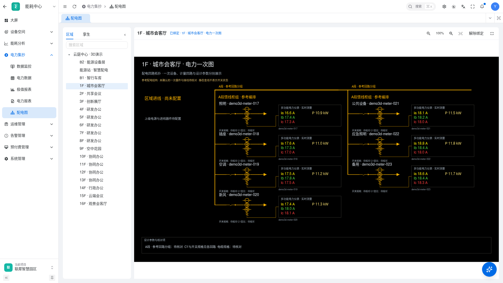

# 电力一次图绘制与案例

CLI v0.9.0 起，先按[组件与图元搜索](component-search.md)查询组件和图元详情，再按本文生成画布、独立绑定设备，并按[能源接入指南](primary-diagram-energy.md)挂接区域。更新 CLI 时同步升级随包 Skills，搜索结果用于核对可用组件和图形来源。

本指南覆盖按区域生成、按图纸复原和区域加图纸匹配三种入口。开始时确认项目、区域范围、参考风格、可编辑粒度和实际测点来源。环境地址与认证取值从目标环境说明读取，文中编号均为占位符。

## 按任务阅读

| 当前任务 | 参考资料 |
| --- | --- |
| 确定绘制流程、布局和验收 | 本文 |
| 选择组件、图库图元、端口和数据字段 | [一次图组件与图元](primary-diagram-components.md) |
| 独立电表绑定、实时推送、接入能耗中心 | [能源接入与数据绑定](primary-diagram-energy.md) |
| 查看可改用的模型和完整画布 | [电气模型示例](../assets/primary-diagram/region-model.json)、[画布示例](../assets/primary-diagram/region-canvas.json) |
| 读取 CAD 图框、文字与渲染图 | `ur-doc` 技能的 CAD 工作流 |

## 从输入到可编辑草稿

1. **读取范围**。查询区域树，明确所选区域及下级区域，读取其设备、产品物模型和已有区域配置。采用 `productID + deviceName` 作为电表身份，建立区域、用途、回路与测点的对应表。
2. **核对图纸**。先看整图，再放大变压器、进线、联络、SVG、补偿和全部馈线柜。记录柜号、回路编号、用途、容量、开关规格、CT 变比、线缆及接地关系。已有 CAD 渲染结果可直接复用。
3. **建立电气模型**。AI 输出母线、柜组、回路、设备节点、显式连接和测点，程序计算坐标。区域层级用于分组，供电关系按图纸或已有配置确认。资料不足时生成参考草稿，并在节点写入 `referenceOnly: true`、连接写入 `verified: false` 及判断依据。
4. **匹配图元**。从内置图库接口取得原始图片和来源 ID，逐项看图核对角色、方向、端子及透明通道。使用独立 Image 表达设备，独立 ConnectLine 表达接线，独立 TextCommon 表达文字和读数。
5. **排版与绑定**。展开柜组和器件链，区分一次通流线路与计量二次连接。已确认的设备属性写入对应回路，无测点时显示带单位的 `--`。设计规格放参数区。
6. **打开编辑器**。普通生成保存为草稿。支持选择、移动和缩放设备、文字及连接线，保存后重开核对。自然语言局部修改沿用稳定 ID，保留上一版供恢复。
7. **发布与接入能源**。获得发布授权后，备份草稿、发布快照和绑定配置，保存并发布，回读确认，再按区域绑定到能耗中心配电图。具体接口见能源接入指南。

## 布局与信息密度

采用安科瑞黑底金线参考时，母线构成骨架，柜组和回路用途构成阅读层次。主进线集中展示三相电压、三相电流和功率，普通馈线展示 Ia、Ib、Ic、P。其他已配置测点保存在模型中，需要时进入详情或修改画布查看。

每条有设计依据的馈线依次展开保护器件、互感器与出线。多功能仪表放在独立功能框中，二次计量线从模型声明的 CT 端口引出。断路器保留断口，设备的引线端点与连接线重合。

常规区域可采用 `layout: "engineering"`。当前布局每列最多四路，短柜共列时分别保留母线起点与间距，A/B 段独立安排。复杂图纸沿用完整柜列布局，按图纸保留特殊柜内部支路和参数。

缺少进线档案的区域显示进线待配置。当前页面可省去左侧说明框和底部来源备注，参考属性、连接依据和数据来源记录在模型与案例中，图上的待核对提示放在相关设备或参数位置。

## 案例一　完整 T2 图纸复原

输入为 `2.dwg`，目标为黑底金线的完整 T2 系统。按原图区分变压器、总进线、联络柜、SVG 柜、补偿柜和 T2D4～T2D9 的 60 条馈线。

- 核对每路编号、用途和规格，保留图纸参数表。补偿柜按原图区分开关、CT、熔断器、接触器、补偿级和接地，重复级按原图省略标记表达。
- 变压器上下绕组接法、进出线和接地关系逐项核实。电表绑定只填写能明确对应原图回路的实际测点，其余读数显示 `--`。
- 全图保存在独立大屏，按实际区域生成新图时可与图纸版本并存。图纸版本的参数用于该系统复原。
- 验收覆盖 60 路数量、柜号、关键参数、特殊柜支路、器件断口、保存重开和完整规模下的缩放性能。

## 案例二　按真实区域拆图

示例项目有 19 个下级区域，共 129 台独立电表，其中 128 台为平台实时演示电表，另有 1 台离线历史电表。生成 19 张区域明细与 1 张顶层总览，区域树逐项选择对应图。

以含 7 台电表的楼层为样板，按用途排列照明、插座、空调、新风、公共设备、应急照明、备用，每台电表独立成回路。七路排为四路加三路，每路分别引用保护开关和三个单相 CT 图元，并展示该表独有的 Ia、Ib、Ic、P。当前区域缺少保护配置图纸，因此器件与柜组为参考结构，开关规格和 CT 变比标待核对。

含离线设备的楼层将该设备单独归入待核对分组，并在回路附近注明历史上报时间。能源站两台总进线电表按 A/B 段分别展示七项读数。顶层总览复用这两台进线的身份，并列出下级区域索引。

本案例现网验收通过 20 张图的入口、图元数量和文字边界检查。实际抽查的 24 个测点在首载后继续变化，设备、文字、连接线通过浏览器事件驱动的拖动、保存和重开核对。

## 可直接改用的示例

`assets/primary-diagram/region-model.json` 提供两条独立馈线的完整语义模型，测点默认未绑定。`region-canvas.json` 为同一模型经当前编译器生成的完整 GoView 画布，包含组件默认字段，可导入编辑器查看。

使用时先替换项目与区域信息，依据设备物模型填写每路 binding，重新从图库接口取得图元 URL。可直接导入画布示例，在编辑器或画布 JSON 中填写实际设备和属性。SaaS 开发环境还可以使用 `parseElectricalDiagram`、`reconcileElectricalBindings`、`compileElectricalCanvas` 校验并生成画布。生产数据只在完成实际回路对应核对后写入。

联犀 SaaS 开发仓库中的实现位于 `apps/web/packages/bigscreen/src/views/bigscreen/electrical/`。`model.ts` 校验对象、引用和测点，`generate.ts` 负责区域与 AI 编排，`canvas.ts` 转换原生组件，`engineering.ts` 负责区域工程排版。

## 发布前验收

- 对照整图与局部图，核对柜列、回路、设备角色、关键编号和设计参数。
- 确认设备、文字及连线各自可选，开关断口和 CT 端口接线正确，整图无白块、裁切及文字碰撞。
- 从能耗中心实际菜单选择区域，检查绑定身份、读数、放大、缩小、重置和区域切换。
- 等待非空读数加载后再连续采样，观察目标设备推送及数值变化，记录离线和无测点情况。
- 备份并回读发布快照，实际移动后保存重开。样板验收完成后再批量应用同类区域。
